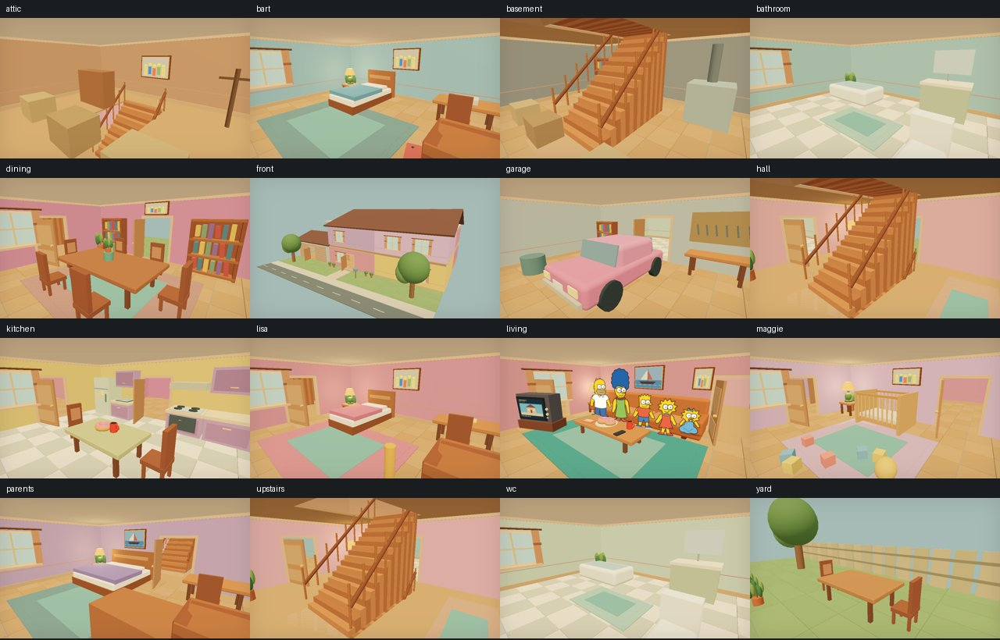
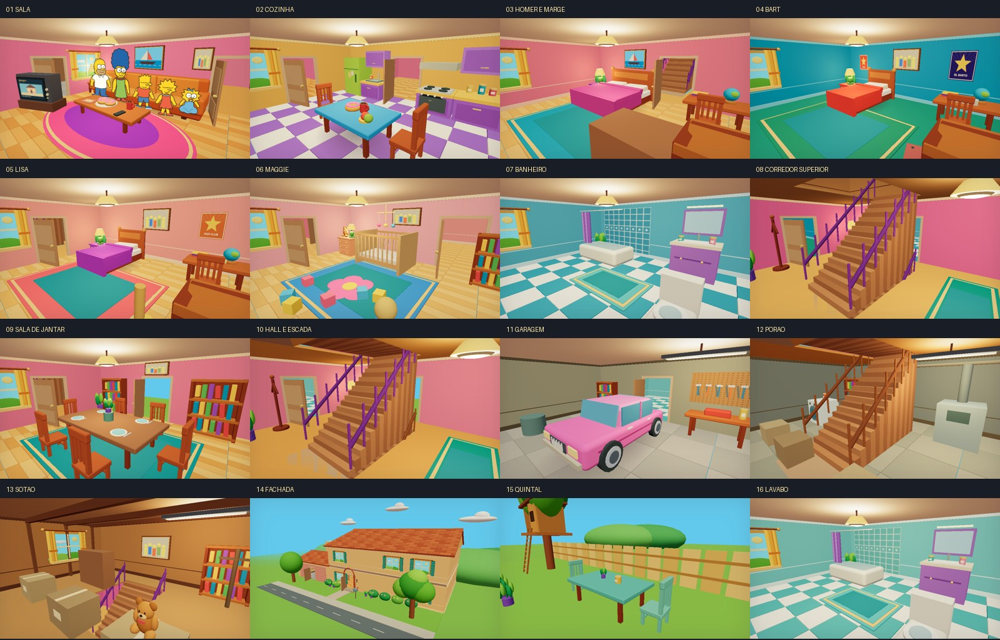

# Revisão visual dos 16 ambientes

A revisão usa a nova referência como direção artística e mantém a aplicação existente. O ponto anterior está na tag `visual-before-20261023`.

## Comparação visual

| Antes | Depois |
| --- | --- |
|  |  |

[Estúdio atualizado](verification/visual/studio.jpg) · [Sala com sombras](verification/visual/living-medium.jpg) · [Fachada](verification/visual/front-medium.jpg) · [Iluminação noturna](verification/visual/living-night.jpg)

## Alterações

| Ambiente existente | Tratamento visual |
| --- | --- |
| Sala | Paredes rosa, sofá laranja com almofadas, tapete oval rosa/roxo, cortinas amarelas e cerâmicas |
| Cozinha | Armários roxos, geladeira verde, mesa azul, piso quadriculado lilás, potes e detalhes do fogão |
| Jantar | Madeira quente, tapete turquesa, pratos, talheres e estantes coloridas |
| Hall/escada | Rosa, corrimão roxo, passadeira verde, cabideiro e luminária afastada da escada |
| Lavabo | Paleta verde-água, azulejos, armário lilás, espelho e acessórios |
| Garagem | Piso de concreto, luz de oficina, ferramentas, carro rosa com vidros, frisos e rodas detalhadas |
| Fachada/rua | Paredes ocre, telhas, venezianas verdes, moldura de entrada, vegetação e céu cartoon |
| Quintal | Mesa e cadeiras verdes, churrasqueira, cerca dourada, casa na árvore e paisagismo |
| Corredor superior | Rosa mais intenso, corrimão roxo, passadeira e detalhes de madeira |
| Quarto do casal | Paredes coral, roupa de cama rosa, travesseiros separados, cabeceira e criado-mudo roxo |
| Quarto de Bart | Paredes azuis, piso verde, cama vermelha, pôsteres e objetos de estudo |
| Quarto de Lisa | Coral, cama roxa, pôster de jazz, livros, globo e detalhes do instrumento |
| Quarto de Maggie | Rosa suave, tapete com flor, berço, móbile, ursinho e cômoda |
| Banheiro | Azul, piso quadriculado, azulejos, cortina roxa e acessórios de bancada |
| Porão | Tons utilitários, máquina de lavar, tubulações, armazenamento e iluminação industrial |
| Sótão | Madeira, vigas aparentes, caixas com fitas/etiquetas, estante, janela e objetos guardados |

Os 16 IDs originais são mantidos, inclusive o lavabo. A vista externa é um enquadramento da fachada existente; não foi criado um cômodo novo para substituir nenhum ambiente.

## Preservação

- `shared/`, `server/`, módulos de áudio, painéis, sprites e contratos não foram modificados.
- Posições dos cômodos, portais, escadas, caminhos e presets de câmera permanecem iguais.
- A paleta é isolada em `src/scene/artDirection.ts`; decoração adicional está em `RoomDetails.tsx`.
- Ações de TV, geladeira e portas continuam nos componentes originais.
- Sem novas dependências. Geometrias de esferas/cilindros e materiais são reutilizados; texturas procedurais pequenas (64–320 px) têm descarte quando aplicável. Cômodos continuam carregados seletivamente.
- A iluminação continua respondendo à energia e ao período do dia. O modo baixo mantém sombras dinâmicas desativadas; médio/alto utilizam os limites já existentes.

## Verificação

57 testes de regressão e build TypeScript/Vite aprovados. A revisão visual captura todos os ambientes e faz verificações adicionais de qualidade média e noite. Os fluxos do painel/overlay são verificados pelo teste de navegador já existente. Relatórios e capturas desta revisão ficam em `docs/verification/visual/`.

```bash
npm test
npm run build
CHROMIUM_PATH=/usr/bin/chromium npm run test:browser
CHROMIUM_PATH=/usr/bin/chromium npx tsx scripts/inspect-rooms.ts
CHROMIUM_PATH=/usr/bin/chromium SCENE_QUALITY=medium ROOM_IDS=living,kitchen,parents,front,yard ROOM_OUTPUT=test-results/visual-medium npx tsx scripts/inspect-rooms.ts
CHROMIUM_PATH=/usr/bin/chromium SCENE_QUALITY=medium SCENE_NIGHT=1 ROOM_IDS=living,front ROOM_OUTPUT=test-results/visual-night npx tsx scripts/inspect-rooms.ts
```

As capturas são renders da casa 3D; não são imagens usadas como cenários. A direção de arte aproxima cores, materiais e objetos da referência com modelagem procedural. Não constitui reprodução exata da imagem. Sprites e limitações funcionais documentadas na entrega anterior permanecem; desempenho para transmissão deve ser aferido no hardware real, pois a validação aqui usa SwiftShader.
